# Aula 03 — Instalação do EAP (tarefa 1 da prova)

> **Fonte desta aula:** [github.com/antvale/rhcja-certification](https://github.com/antvale/rhcja-certification/blob/main/installing-using-jarinstaller/jboss-eap-jar-install.md)
> — guia de instalação do **JBoss EAP 7.4** via instalador JAR (GUI e silenciosa),
> variáveis de ambiente, serviço e SELinux. Todo o conteúdo foi traduzido e adaptado
> ao estilo do curso; as capturas de tela estão na pasta `imagens/`.

## O que a prova pede

Enunciado clássico (dos seus documentos):

```
1 - Install and configure jboss domain
    a. Download and install jboss under /opt/ex248 (ou /opt/eap, ou o caminho indicado),
       from http://materials.example.com/jboss-eap-installer.jar
    b. Create a user "<usuario>" and password "<senha>"
```

Os valores de usuário/senha **mudam a cada prova**. Relatos seus: `jboss/rocky`,
`webmin/secret 1`, `PostRoll/crackroll`. Trate-os como variáveis da questão.

## 1. Pré-requisitos

```bash
# Java instalado
java -version

# Usuário do JBoss (se a prova pedir)
useradd -r -g jboss -u 299 -c "Jboss Account" -d /opt/eap -s /bin/bash jboss
# ou simplesmente usar o usuário corrente, como nos relatos (student/root)
```

## 2. Instalação via instalador JAR — passo a passo da GUI (EAP 7.4)

```bash
cd /tmp
# na prova: wget http://materials.example.com/jboss-eap-installer.jar
# no lab:  usar o jboss-eap-7.4.0-installer.jar baixado do Customer Portal
sudo java -jar jboss-eap-7.4.0-installer.jar
```

### Passo 1 — idioma
Selecione **English** no *dropdown* e clique **OK**.

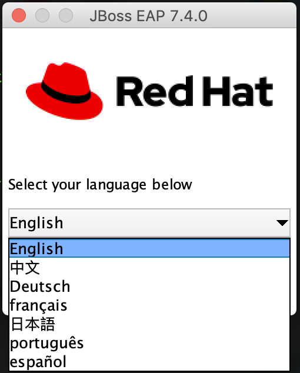

### Passo 2 — contrato de licença
Leia (rapidinho) e marque que concorda com as condições → **NEXT**.

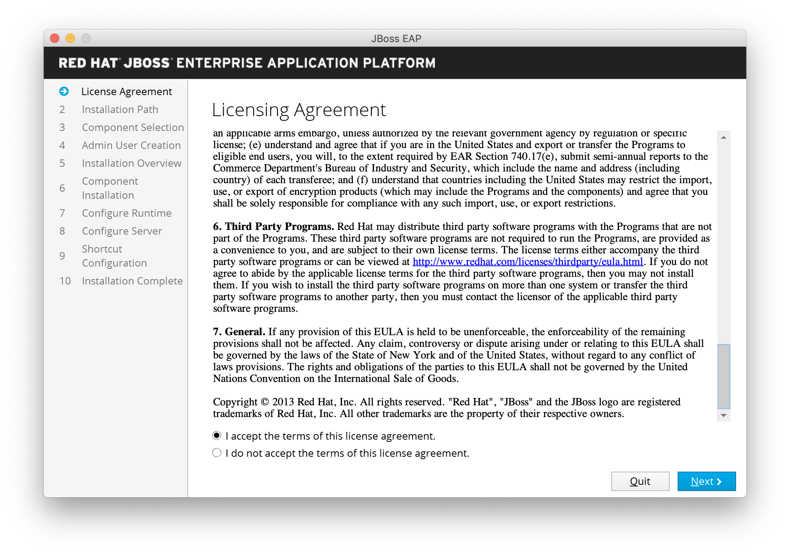

### Passo 3 — caminho de instalação
Digite **exatamente** o caminho pedido no enunciado (ex.: `/opt/ex248`,
`/opt/eap`; o padrão do instalador é `/opt/jboss-eap-7.4`).

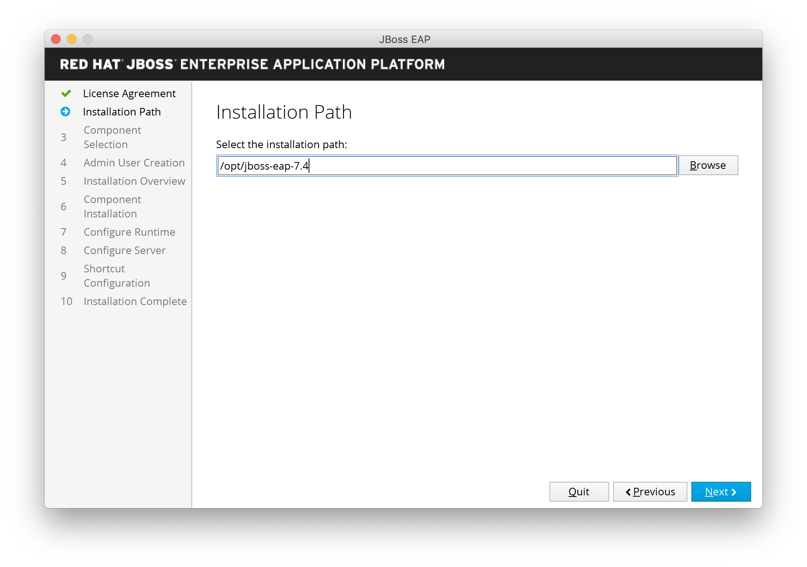

> ⚠️ **Aviso de teclado:** em algumas VMs o layout muda para ENG no meio da digitação —
> o que era `-` vira `/` e o que era `'` vira `-`. Confira o caminho **no teclado
> antes de dar NEXT** (um `-` trocado por `/` instala no lugar errado).

### Passo 4 — seleção de componentes
Deixe as opções **padrão** e clique **NEXT** (EAP, AppClient, XMLs/XSDs, Modules,
Welcome Content).

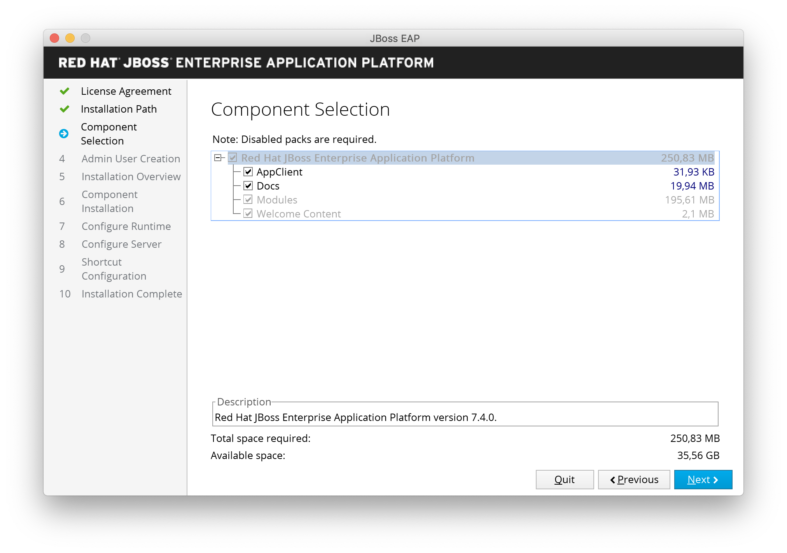

### Passo 5 — usuário de administração
Crie o usuário que acessa o console (na prova: **usuário e senha do enunciado**).

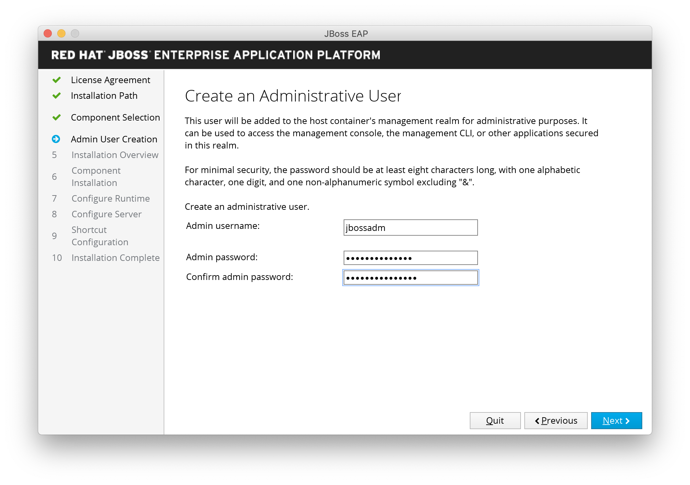

### Passo 6 — resumo da instalação
Confira o *overview* (volte e corrija se algo estiver errado) → **NEXT**.

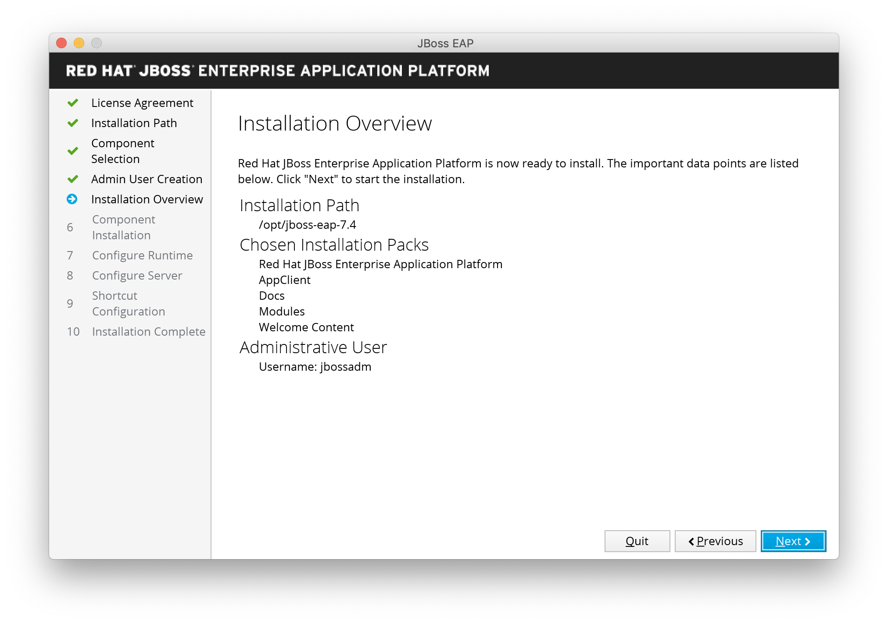

### Passo 7 — instalação em andamento
O instalador descompacta os componentes; ao terminar mostra o resumo → **NEXT**.

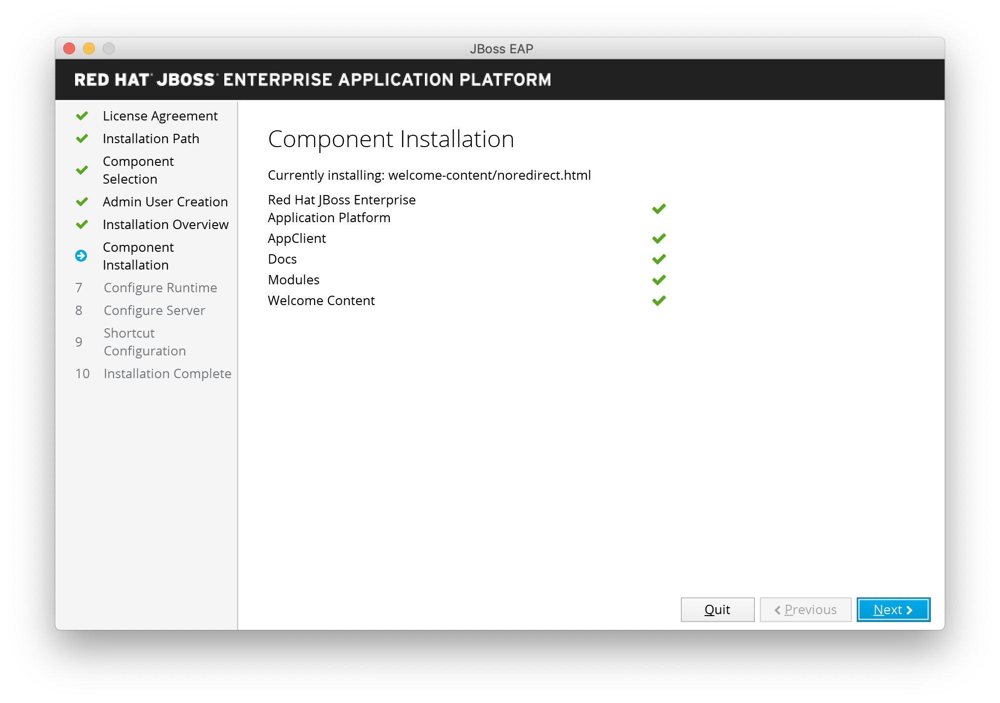

### Passo 8 — configuração do runtime
Selecione **"Perform default configuration"** → **NEXT** (a configuração default já
serve para a prova — na Parte 1 você vai limpar domínio/grupo à mão mesmo assim).

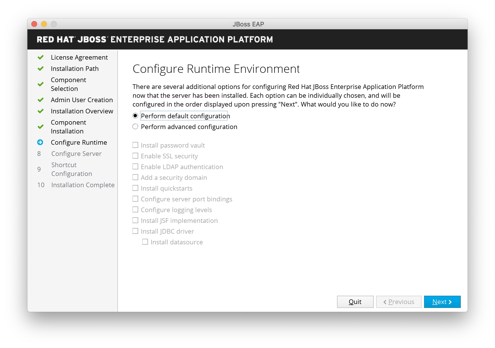

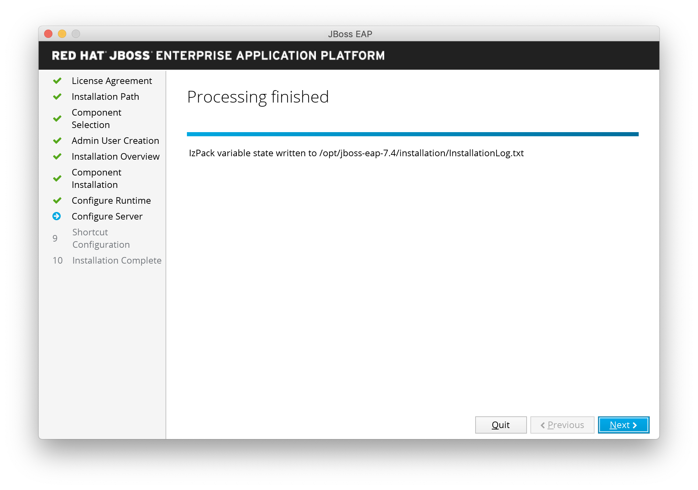

### Passo 9 — gerar o script de instalação (importante!)
Selecione **"Generate installation script and properties files"** — é isso que permite
**reinstalar depois sem GUI** (seção 3). Dê um nome, ex.: `jboss-eap-7.4-install-file`.

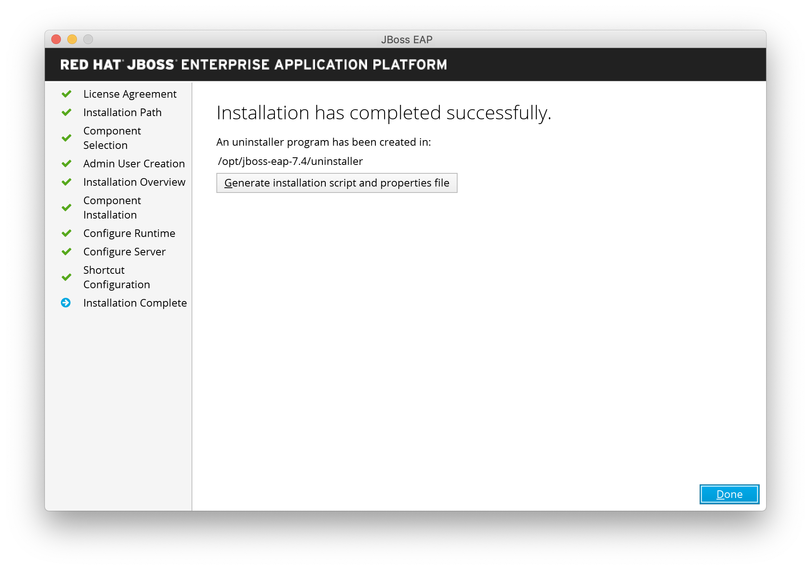

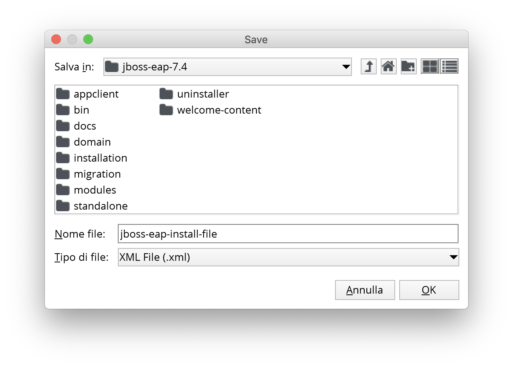


> **Nota:** o nome do arquivo mudou ao longo das versões — de `jboss-eap-install-file`
> para `jboss-eap-7.4-install-file`. Anote onde ele foi salvo (e a pasta do
> *uninstaller*, caso precise desinstalar). Clique **DONE**.

> **Armadilha 1:** o instalador costuma sugerir `/opt/jboss-eap-7.x`. Se a prova pediu
> outro caminho, **finalize e depois mova**:
> ```bash
> mv /opt/jboss-eap-7.0 /opt/eap
> ```
> O relato dos documentos diz literalmente: *"Se depois da instalação via interface gráfica
> o jboss estiver em um local diferente, você só faz um `mv` para o lugar correto."*

> **Armadilha 2:** o instalador cria `standalone` **e** `domain`. A prova é em domain mode:
> confira se `bin/domain.sh` e `configuration/domain.xml` existem.

## 3. Instalação silenciosa (sem GUI) — EAP 7.4

Útil no lab (e se a prova pedir instalação automatizada): usa os arquivos gerados no
**Passo 9**:

- `jboss-eap-install-file.xml` — o "roteiro" da instalação (pacotes, caminho, admin user);
- `jboss-eap-install-file.xml.variables` — só com a senha (`adminPassword=...`).

> ⚠️ Use `sudo` para abrir os dois arquivos: o `.xml` vem com permissão `600` e o
> `.variables` com `644`, ambos do root.

```bash
# 1) garanta que o xml tem o usuário e que a senha está no .variables
grep admin jboss-eap-install-file.xml
#   <entry key="adminUser" value="jbossadm"/>
#   <entry autoPrompt="true" key="adminPassword"/>
sudo vi jboss-eap-install-file.xml.variables
#   adminPassword=JBoss@RedHat123

# 2) instalação fully automated (sem tocar em nada)
sudo java -jar jboss-eap-7.4.0-installer.jar jboss-eap-install-file.xml
```

Saída esperada (resumo):

```
Checking for corresponding .variables file
Variables file detected: .../jboss-eap-install-file.xml.variables
[ Starting automated installation ]
Read pack list from xml definition.
[ Starting to unpack ]
[ Processing package: Red Hat JBoss Enterprise Application Platform (1/5) ]
...
[ Processing finished ]
[ Writing the uninstaller data ... ]
[ Automated installation done ]
```

```bash
# 3) confira a árvore criada (bin, domain, standalone, modules, ...)
ls /opt/jboss-eap-7.4
```

## 4. Pós-instalação: `JBOSS_HOME`, usuário `jboss` e serviço

### 4.1 Variáveis de ambiente

Edite o `~/.bashrc` e adicione **no final** (depois de *"User specific aliases..."*):

```bash
export JBOSS_HOME=/opt/jboss-eap-7.4
export PATH=$PATH:$JBOSS_HOME/bin
```

> **Dica do guia:** use **sempre `$JBOSS_HOME`** nos comandos em vez do caminho absoluto
> — evita digitar o caminho errado. Faça `logout`/`login` e valide:

```bash
echo $JBOSS_HOME        # /opt/jboss-eap-7.4
which standalone.sh     # /opt/jboss-eap-7.4/bin/standalone.sh
```

### 4.2 Usuário de sistema `jboss`

```bash
sudo useradd -r jboss          # "-r" = usuário de sistema (não loga)
id jboss                       # uid < 1000
sudo chown -R jboss:jboss $JBOSS_HOME
```

### 4.3 Subir e validar na mão

```bash
sudo -u jboss $JBOSS_HOME/bin/standalone.sh     # (ou domain.sh, para a prova)
```

Linha de sucesso no log:

```
WFLYSRV0025: JBoss EAP 7.4.0.GA (WildFly Core 15.0.2.Final-redhat-00001) started in 13515ms
```

```bash
curl http://localhost:8080        # welcome page do EAP
```

Pare com `Ctrl+C` (log: `WFLYSRV0050: ... stopped`).

### 4.4 Serviço de inicialização (init.d / systemd) — opcional no lab

Dentro de `$JBOSS_HOME/bin/init.d` existem 2 arquivos: `jboss-eap-rhel.sh` e
`jboss-eap.conf`. Edite a conf:

```bash
sudo -u jboss vi $JBOSS_HOME/bin/init.d/jboss-eap.conf
```

Descomente/ajuste:

```properties
JAVA_HOME="/etc/alternatives/java_sdk"     # JDK correto (veja /etc/alternatives)
JBOSS="/opt/jboss-eap-7.4"
JBOSS_USER=jboss
JBOSS_MODE=standalone                      # (domain, na prova)
JBOSS_CONFIG=standalone.xml                # (domain.xml, na prova)
JBOSS_CONSOLE_LOG="/var/log/jboss-eap/console.log"
```

Instale o serviço:

```bash
sudo cp $JBOSS_HOME/bin/init.d/jboss-eap.conf /etc/default/
sudo cp $JBOSS_HOME/bin/init.d/jboss-eap-rhel.sh /etc/init.d/jboss-eap
sudo chmod 755 /etc/init.d/jboss-eap

sudo systemctl daemon-reload
sudo systemctl enable jboss-eap
sudo systemctl start jboss-eap
sudo systemctl status jboss-eap
```

> **SELinux (lab RHEL):** se der `Permission denied` escrevendo em
> `/var/log/jboss-eap/console.log`, gere e carregue a policy:
> ```bash
> sudo ausearch -c 'jboss-eap' --raw | sudo audit2allow -M jboss-eap
> sudo semodule -i jboss-eap.pp
> sudo systemctl start jboss-eap
> ```

## 5. Instalação via ZIP (alternativa)

```bash
cd /opt
unzip jboss-eap-7.0.zip
mv jboss-eap-7.0 eap
```

## 6. Usuário de gerenciamento (quando a prova pede "create a user")

```bash
cd /opt/eap/bin
./add-user.sh
```

Respostas interativas:
```
What type of user do you wish to add?
 a) Management User (mgmt-users.properties)
 b) Application User (application-users.properties)
(a): a

Username: webmin
Password: <senha da questão>      # reconfirme
Groups (blank for none):          # enter
Is this correct? yes
```

- Usuário de **gerenciamento** → `mgmt-users.properties` (acesso ao console 9990 / CLI).
- Usuário de **aplicação** → `application-users.properties` (JMS, EJB remoto) — usado na Aula 11.

## 7. Validação obrigatória

```bash
# subir o domínio de teste
cd /opt/eap/bin
./domain.sh
```

Verifique:
```bash
# outro terminal
curl -I http://127.0.0.1:9990        # Management console responde
ss -tlnp | grep -E '8080|9990|9999'  # portas de pé
```

Console: `http://127.0.0.1:9990` → login com o usuário criado.

> **Dica da prova:** o domínio padrão sobe com `server-one`, `server-two`, `server-three`
> e dois grupos. **Não se assuste** — na Parte 1 você vai apagar tudo isso (Aula 04).

## Checklist desta tarefa

- [ ] Instalado no diretório EXATO pedido (conferido **no teclado**, sem `/` trocado)
- [ ] Usuário/senha da questão criados (mgmt)
- [ ] Arquivo de instalação silenciosa gerado (Passo 9) — guardado para reuso
- [ ] `JBOSS_HOME` no `.bashrc` e `which standalone.sh` batendo
- [ ] `./domain.sh` sobe sem erro
- [ ] Console `:9990` acessível e loga
- [ ] Anotado no rascunho: caminho do JBoss, usuário e senha

## Exercício

Instale o EAP na sua VM em `/opt/eap` pelo caminho GUI (siga os 9 passos acima,
comparando cada tela com as imagens), **gere o script de instalação silenciosa**,
depois rode a reinstalação silenciosa de cima, crie o usuário `webmin/secret1`,
suba o domínio, logue no console e pare tudo com `Ctrl+C`.
