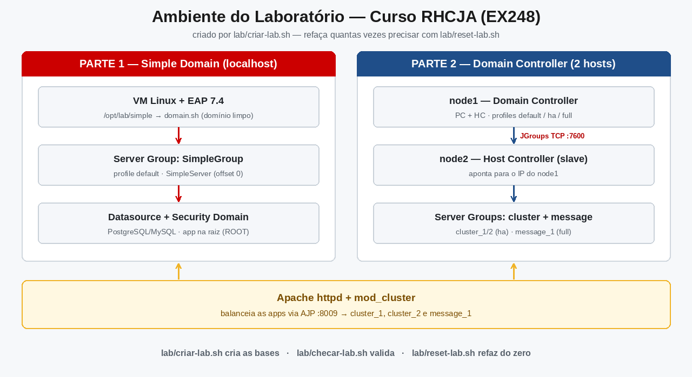

# Laboratório RHCJA — guia completo de uso

Esta pasta deixa o **ambiente de prática montado em 3 comandos**. Os scripts fazem a
parte repetitiva da prova (criar os *base directories* de domínio limpos, no formato
exato do EX248) e deixam para **você** a parte que é cobrada: grupos, JVM, servidor,
datasources, segurança, cluster, JMS e balanceamento.



**Neste guia:**

1. [O que é o laboratório](#1-o-que-é-o-laboratório)
2. [Escolha seu ambiente](#2-escolha-seu-ambiente)
3. [Windows (PowerShell) — passo a passo](#3-windows-powershell--passo-a-passo)
4. [WSL / Linux — passo a passo](#4-wsl--linux--passo-a-passo)
5. [Docker — treino rápido](#5-docker--treino-rápido)
6. [O que os scripts fazem por dentro](#6-o-que-os-scripts-fazem-por-dentro)
7. [O que a prova cobra × o que o script já faz](#7-o-que-a-prova-cobra--o-que-o-script-já-faz)
8. [Ciclo de prática (regra das 2 vezes)](#8-ciclo-de-prática-regra-das-2-vezes)
9. [Treinar a Tarefa 2 à mão](#9-treinar-a-tarefa-2-à-mão)
10. [Solução de problemas](#10-solução-de-problemas)
11. [Perguntas frequentes](#11-perguntas-frequentes)

---

## 1. O que é o laboratório

A prova EX248 começa com um servidor EAP "vazio": um *domain controller* recém-criado,
**sem server groups e sem servers** (isso é a famosa **Tarefa 2**). Criar esse estado
à mão leva ~15 minutos e é igual toda vez — os scripts fazem isso em segundos:

| Script | O que faz | O que ele **não** faz |
|---|---|---|
| `criar-lab` | Copia `$JBOSS_HOME/domain` para `$LAB_DIR/<nome>`, **apaga** os blocos `<servers>` e `<server-groups>` padrão e **renomeia** o host (igual à Tarefa 2) | Não cria grupos, servidores, JVMs, datasources, deployments — **isso é você fazer** (é o que cai na prova!) |
| `checar-lab` | Confere pré-requisitos (Java, EAP), as bases criadas (XML limpo, host renomeado) e se o console `:9990`/apps `:8080` estão no ar (só leitura) | Não altera nada |
| `reset-lab` | Apaga as bases `simple`/`node1`/`node2` para você refazer do zero | Não apaga o EAP nem a pasta do lab inteira |

Cada script existe em duas versões: **`.sh`** (WSL/Linux) e **`.ps1`** (Windows).
As duas fazem exatamente a mesma coisa.

### Arquivos da pasta

```
lab/
├── README.md        ← este guia
├── criar-lab.sh     ← cria as bases limpas      (WSL/Linux)
├── checar-lab.sh    ← valida tudo ✓/✗           (WSL/Linux)
├── reset-lab.sh     ← apaga para refazer        (WSL/Linux)
├── criar-lab.ps1    ← cria as bases limpas      (Windows)
├── checar-lab.ps1   ← valida tudo [OK]/[XX]     (Windows)
└── reset-lab.ps1    ← apaga para refazer        (Windows)
```

### Referência rápida de parâmetros

**WSL / Linux** — variáveis de ambiente antes do comando:

| Variável | Padrão | Para quê |
|---|---|---|
| `JBOSS_HOME` | `/opt/eap` | Onde o EAP está instalado (fonte da cópia) |
| `LAB_DIR` | `/opt/lab` | Onde criar as bases de prática |

```bash
bash criar-lab.sh              # cria só "simple"  (Parte 1)
bash criar-lab.sh tudo         # cria simple + node1 + node2 (Partes 1 e 2)
bash checar-lab.sh             # valida (exit 0 = tudo certo)
bash reset-lab.sh              # apaga (pede "sim" para confirmar)
bash reset-lab.sh -y           # apaga sem perguntar
```

**Windows** — parâmetros no final do comando:

| Parâmetro | Padrão | Para quê |
|---|---|---|
| `-JbossHome` | `%JBOSS_HOME%` | Onde o EAP está instalado |
| `-LabDir` | `%USERPROFILE%\lab-eap` | Onde criar as bases de prática |
| `-Tudo` | (desligado) | Cria simple + node1 + node2 |
| `-Modo` | `simple` | Alternativa ao `-Tudo`: `-Modo tudo` |
| `-y` (só no reset) | (desligado) | Não pergunta, apaga direto |

```powershell
powershell -ExecutionPolicy Bypass -File .\criar-lab.ps1           # cria "simple"
powershell -ExecutionPolicy Bypass -File .\criar-lab.ps1 -Tudo     # cria as 3 bases
powershell -ExecutionPolicy Bypass -File .\checar-lab.ps1          # valida (exit 0/1)
powershell -ExecutionPolicy Bypass -File .\reset-lab.ps1           # apaga (pede 'sim')
powershell -ExecutionPolicy Bypass -File .\reset-lab.ps1 -y        # apaga direto
```

> ⚠️ **No Windows use sempre `-ExecutionPolicy Bypass -File`.** Por padrão o
> Windows bloqueia arquivos `.ps1`; sem o Bypass aparece *"o arquivo não está
> assinado digitalmente…"*.

---

## 2. Escolha seu ambiente

| Ambiente | Melhor para | Parte 1 | Parte 2 (2 hosts) | Esforço |
|---|---|---|---|---|
| **Windows nativo** (PowerShell) | Quem só tem Windows 10/11 | ✅ completo | ✅ com os edits da Aula 08 | Baixo |
| **WSL / Linux** (VM ou nativo) | Quem quer o cenário mais próximo da prova (RHEL-like) | ✅ completo | ✅ completo (inclui Apache/mod_cluster) | Médio |
| **Docker** ([imagem/](../imagem/README.md)) | Treino rápido sem instalar nada | ✅ completo | ❌ (1 host só) | Mínimo |

**Recomendação:** instale o EAP **uma vez** (Aula 03) no seu ambiente principal
e use este lab todos os dias até a prova. O Docker é bônus para treinar em
máquina alheia/emprestada.

### Pré-requisitos (todos os ambientes)

1. **JBoss EAP 7.4** instalado — siga a [Aula 03](../03-Aula-03-Instalacao-do-EAP.md).
   Qualquer instalação serve (ZIP, instalador GUI ou RPM), desde que exista a pasta
   `domain/` dentro dela.
2. **JDK 8 ou 11** — o EAP 7.4 **não** roda com JDK 17/21. Confira: `java -version`.
3. **Disco:** ~1 GB livre por base criada (o domínio copiado é grande).

---

## 3. Windows (PowerShell) — passo a passo

### 3.1 Preparar o ambiente (uma vez só)

**Passo 1 — Instale o JDK 11 e o EAP** (se ainda não fez): veja a
[Aula 03](../03-Aula-03-Instalacao-do-EAP.md). Exemplo com o instalador gráfico em
`C:\jboss-eap-7.4` (o instalador **padrão** usa `C:\Program Files\...` — também
funciona; os scripts tratam espaços no caminho).

**Passo 2 — Defina o `JBOSS_HOME`** para sempre (uma vez só):

```powershell
setx JBOSS_HOME C:\jboss-eap-7.4
```

> 📌 `setx` grava no registro do Windows: **feche o terminal e abra um novo**
> antes de continuar (`echo $env:JBOSS_HOME` no terminal novo deve mostrar o caminho).

**Passo 3 — Confirme que tudo está no lugar:**

```powershell
java -version                          # deve mostrar 1.8 ou 11.x
echo $env:JBOSS_HOME                   # deve mostrar o caminho do EAP
dir "$env:JBOSS_HOME\domain\configuration\host.xml"   # deve existir
```

### 3.2 Criar o laboratório

```powershell
cd C:\Users\SEU-USUARIO\...\jboss\lab

powershell -ExecutionPolicy Bypass -File .\criar-lab.ps1
```

Saída esperada:

```
EAP: C:\jboss-eap-7.4
Lab: C:\Users\SEU-USUARIO\lab-eap
  [OK] C:\Users\SEU-USUARIO\lab-eap\simple  (host name='simple', sem servers/server-groups)
       Sobe com: & "C:\jboss-eap-7.4\bin\domain.bat" -Djboss.domain.base.dir="C:\Users\SEU-USUARIO\lab-eap\simple"

Pronto! Depois: powershell -ExecutionPolicy Bypass -File checar-lab.ps1
```

Para praticar as **duas partes** da prova, crie as 3 bases de uma vez:

```powershell
powershell -ExecutionPolicy Bypass -File .\criar-lab.ps1 -Tudo
```

Quer o lab em outro disco (ex.: `D:\lab-eap`) ou outro EAP? Acrescente:

```powershell
powershell -ExecutionPolicy Bypass -File .\criar-lab.ps1 -LabDir D:\lab-eap -JbossHome D:\eap
```

### 3.3 Validar

```powershell
powershell -ExecutionPolicy Bypass -File .\checar-lab.ps1
```

Saída esperada (tudo `[OK]`; exit code 0):

```
== Pre-requisitos ==
  [OK] java no PATH
  [OK] EAP em C:\jboss-eap-7.4
== Base directories ==
  [OK] simple: dominio limpo (sem servers padrao)
  [OK] simple: sem server-groups padrao
  [OK] simple: nome do host correto
...
Resultado: N ok, 0 problema(s).
```

Se aparecer `[XX]` em alguma linha, veja a [seção 10](#10-solução-de-problemas).

### 3.4 Subir o domínio (Parte 1)

Abra um terminal **novo** e rode (cole o comando que o `criar-lab.ps1` imprimiu —
ele já vem com aspas, importantes se o EAP está em `C:\Program Files\...`):

```powershell
& "$env:JBOSS_HOME\bin\domain.bat" -Djboss.domain.base.dir="$env:USERPROFILE\lab-eap\simple"
```

Aguarde a linha `WFLYDC0002` / "started in". O console fica **aberto neste terminal**
— não feche enquanto pratica. Para verificar:

| Item | Endereço |
|---|---|
| Console de gestão (UI) | <http://localhost:9990> — usuário/senha que você criou na Aula 03 |
| CLI (comandos do curso) | `& "$env:JBOSS_HOME\bin\jboss-cli.bat" -c --controller=127.0.0.1:9990` |
| Aplicativos | <http://localhost:8080> (quando houver servidor no ar) |

Pratique a [Parte 1](../12-Laboratorio-Parte1-Gabarito.md) por aqui. Quando quiser
**parar**: `Ctrl+C` no terminal do `domain.bat` (ou feche a janela).

### 3.5 Resetar e refazer

Com o domínio **parado** (Ctrl+C antes! senão os arquivos ficam travados):

```powershell
powershell -ExecutionPolicy Bypass -File .\reset-lab.ps1 -y
powershell -ExecutionPolicy Bypass -File .\criar-lab.ps1
```

Repita o ciclo [as 2 vezes exigidas](#8-ciclo-de-prática-regra-das-2-vezes).

---

## 4. WSL / Linux — passo a passo

### 4.1 Preparar o ambiente (uma vez só)

**Passo 1 — Pré-requisitos do sistema:**

```bash
# RHEL/Rocky/CentOS 8+
sudo dnf install -y java-11-openjdk python3

# Ubuntu / Debian / WSL
sudo apt install -y openjdk-11-jdk python3
java -version    # deve mostrar 11.x (ou 1.8)
```

**Passo 2 — Instale o EAP** ([Aula 03](../03-Aula-03-Instalacao-do-EAP.md)) — por
exemplo descompactando o ZIP:

```bash
sudo mkdir -p /opt && cd /opt
sudo unzip ~/Downloads/jboss-eap-7.4.0.zip
sudo mv /opt/jboss-eap* /opt/eap
echo 'export JBOSS_HOME=/opt/eap' >> ~/.bashrc
echo 'export PATH=$PATH:$JBOSS_HOME/bin' >> ~/.bashrc
source ~/.bashrc
ls $JBOSS_HOME/domain/configuration/host.xml   # deve existir
```

**Passo 3 — Escolha onde o lab vai morar:**

| Estilo | Comando | Quando usar |
|---|---|---|
| Em `/opt/lab` (padrão) | `sudo bash criar-lab.sh` (sempre com sudo) | Máquina dedicada de estudos |
| No seu home (recomendado) | `LAB_DIR=$HOME/lab-eap bash criar-lab.sh` | **Evita briga de permissão** — use este |

Para não digitar `LAB_DIR=` toda vez, grave no `.bashrc`:

```bash
echo 'export LAB_DIR=$HOME/lab-eap' >> ~/.bashrc
source ~/.bashrc
```

> ⚠️ **Regra de ouro de permissão:** escolha **um** estilo (sudo **ou** sem sudo)
> e use **sempre o mesmo**. Se você rodou com `sudo` e depois roda sem, os arquivos
> são do root e os scripts avisam que você precisa `sudo bash reset-lab.sh -y`
> primeiro. Com `LAB_DIR` no home, esse problema não existe.

### 4.2 Criar o laboratório

```bash
cd ~/jboss/lab          # (ou o caminho onde você clonou o repo)

bash criar-lab.sh                # cria /opt/lab/simple ou $LAB_DIR/simple
```

Saída esperada:

```
EAP:  /opt/eap
Lab:  /home/voce/lab-eap
  ✓ /home/voce/lab-eap/simple  (host name='simple', sem servers/server-groups)
    Sobe com: $JBOSS_HOME/bin/domain.sh -Djboss.domain.base.dir=/home/voce/lab-eap/simple
Pronto! Depois: bash checar-lab.sh
```

Duas partes da prova (3 bases):

```bash
bash criar-lab.sh tudo
```

EAP/Lab em outros caminhos:

```bash
JBOSS_HOME=/opt/jboss-eap-7.4 LAB_DIR=/var/lab bash criar-lab.sh tudo
```

### 4.3 Validar

```bash
bash checar-lab.sh
```

Exit code `0` = tudo certo. Qualquer `✗` aparece explicado na
[seção 10](#10-solução-de-problemas).

### 4.4 Subir o domínio (Parte 1)

```bash
$JBOSS_HOME/bin/domain.sh -Djboss.domain.base.dir=$LAB_DIR/simple
# sem LAB_DIR no .bashrc?  $JBOSS_HOME/bin/domain.sh -Djboss.domain.base.dir=/opt/lab/simple
```

| Item | Endereço |
|---|---|
| Console de gestão (UI) | <http://127.0.0.1:9990> |
| CLI | `$JBOSS_HOME/bin/jboss-cli.sh -c --controller=127.0.0.1:9990` |
| Aplicativos | <http://127.0.0.1:8080> |

O console roda em **foreground** — para parar: `Ctrl+C` no mesmo terminal
(alternativa: `pkill -f jboss.domain.base.dir`).

### 4.5 Resetar e refazer

```bash
bash reset-lab.sh -y      # ou sem -y, digitando "sim"
bash criar-lab.sh
```

---

## 5. Docker — treino rápido

Sem VM, sem instalar JDK/EAP na máquina: a pasta [`imagem/`](../imagem/README.md)
gera uma imagem **UBI 9 + EAP 7.4** com o domínio `simple` **já no ar** (estado
pós-Tarefa 2). Resumo:

```powershell
# 1x por máquina: baixe o jboss-eap-7.4.0.zip (conta Red Hat) para a pasta imagem/
cd imagem
docker build -t rhcja-lab .     # ou bash build.sh no WSL
docker run -d --name rhcja-lab -p 8080:8080 -p 9990:9990 -p 9999:9999 rhcja-lab
# console: http://localhost:9990  (admin / Eap@2026)
```

Reset total = `docker rm -f rhcja-lab` e rodar de novo. Guia completo, inclusão do
`lab/` dentro do container e limites (Parte 2 não cabe em 1 container):
[imagem/README.md](../imagem/README.md).

---

## 6. O que os scripts fazem por dentro

Transparência total — depois que decorar, faça [à mão](#9-treinar-a-tarefa-2-à-mão):

1. **Cópia** — `$JBOSS_HOME/domain` → `$LAB_DIR/<nome>` (o EAP original nunca é
   tocado; ele continua sendo o "template" para recriar tudo);
2. **`host.xml`** — duas edições:
   - apaga o bloco inteiro `<servers>...</servers>` (o EAP vem com server-one/two/three);
   - troca `name="localhost"` por `name="simple"` (ou `node1`/`node2`);
3. **`domain.xml`** — apaga o bloco inteiro `<server-groups>...</server-groups>`
   (o EAP vem com main-server-group e other-server-group);
4. **Verificação** — o script confere o resultado (nome certo, blocos removidos) e
   só então imprime `[OK]`; se algo falhar, imprime `[ERRO]` e não continua.

No Linux as edições são feitas com `python3` + regex (o `.sh` exige `python3` no
PATH); no Windows com `[regex]::Replace` do próprio PowerShell.

**Por que apagar os dois blocos?** A prova cobra os dois. Se você esquecer os
`servers`, o `server-one` (offset 0) sobe junto e **conflita de porta** com o
servidor que você criar (também offset 0) — erro clássico de prova.

---

## 7. O que a prova cobra × o que o script já faz

| Etapa da prova | O script faz? | Você faz |
|---|---|---|
| Tarefa 1 — instalar o EAP | ❌ | Uma vez na vida (Aula 03); o lab reusa a instalação |
| **Tarefa 2 — base dir limpo** | ✅ | — (treine à mão [depois](#9-treinar-a-tarefa-2-à-mão)) |
| Tarefa 3 — JVM do grupo | ❌ | `/server-group=G/jvm=...` (Aula 04) |
| Tarefa 4 — server-config + offset | ❌ | `/host=simple/server-config=...` (Aula 04) |
| Tarefa 5 — Undertow (max-conn/AJP) | ❌ | Aula 04 |
| Datasources, root context, security domain | ❌ | Aulas 05–07 |
| Parte 2 — host.xml do node2 (slave, secret, interfaces) | ❌ | Aula 08 (o script só entrega a base limpa com o nome certo) |
| Cluster, JMS, mod_cluster | ❌ | Aulas 09–11 |

Ou seja: o script **só** automatiza o começo. Tudo que é avaliado continua sendo
praticado por você — exatamente como na prova.

---

## 8. Ciclo de prática (regra das 2 vezes)

A prova é 4 horas cronometradas. Quem passa decorou o caminho. Ciclo sugerido:

```
1. bash criar-lab.sh            (ou .ps1 / -Tudo para as 2 partes)
2. subir o domínio              (comando da seção 3.4 / 4.4)
3. seguir a Aula/Gabarito       (12 = Parte 1 · 13 = Parte 2)
4. bash checar-lab.sh           (conferência final ✓)
5. Ctrl+C (parar) + bash reset-lab.sh -y
6. repetir do passo 1 SEM OLHAR O GABARITO — meta: 2x seguidas
```

| Fase | Material | Meta de tempo |
|---|---|---|
| Parte 1 (2x) | [Gabarito Parte 1](../12-Laboratorio-Parte1-Gabarito.md) + Aulas 04–07 | < 2h por rodada |
| Parte 2 (2x) | [Gabarito Parte 2](../13-Laboratorio-Parte2-Gabarito.md) + Aulas 08–11 | < 1h50 por rodada |
| Prova inteira | [Simulado Real](../20-Simulado-Real-EX248.md) | < 3h50 (sobra 10 min de folga) |

Plano de estudo completo (por dia): [Índice do Curso](../00-INDICE-do-Curso.md).

---

## 9. Treinar a Tarefa 2 à mão

Os scripts são muleta de começo; na prova **ninguém cria o base dir pra você**.
Depois de decorar o caminho, apague tudo e faça a Tarefa 2 manualmente:

```bash
# Linux (no Windows, mesmos passos com editor + caminhos \)
cp -r $JBOSS_HOME/domain $LAB_DIR/simple
vim $LAB_DIR/simple/configuration/host.xml      # 1) name="simple"  2) apagar <servers>...</servers>
vim $LAB_DIR/simple/configuration/domain.xml    # 3) apagar <server-groups>...</server-groups>
$JBOSS_HOME/bin/domain.sh -Djboss.domain.base.dir=$LAB_DIR/simple
```

Confira que o domínio subiu **sem** server groups e sem servers no console
(`Runtime → Server Groups` vazio). Só então volte a usar o script no próximo ciclo.

---

## 10. Solução de problemas

### Windows

| Sintoma | Causa | Solução |
|---|---|---|
| *"o arquivo … não está assinado digitalmente"* | `.ps1` bloqueado pela ExecutionPolicy | Use `powershell -ExecutionPolicy Bypass -File .\script.ps1` |
| *"ERRO: JBOSS_HOME nao definido"* | `setx` nunca rodou, ou rodou no mesmo terminal | Rode `setx JBOSS_HOME C:\...`, **abra outro terminal** |
| *"ERRO: EAP nao encontrado"* | Caminho errado ou barra invertida sobrando | `echo $env:JBOSS_HOME` e `dir "$env:JBOSS_HOME\domain"` |
| `checar-lab.ps1` marca `[XX] … base incompleta` | Cópia interrompida | Rode `criar-lab.ps1` de novo (apaga e recria) |
| *"nao consegui apagar"* no reset/criar | Domínio ainda rodando (arquivos travados) | `Ctrl+C` no terminal do `domain.bat` e rode de novo |
| `domain.bat` morre com *port 8080/9990 already in use* | Outro EAP/JVM no ar | `netstat -ano \| findstr :8080` → `taskkill /PID <pid> /F` |
| Console `:9990` não abre depois de subir | Ainda inicializando ou bind errado | Aguarde ~30s; confira o último erro no terminal do `domain.bat` |

### WSL / Linux

| Sintoma | Causa | Solução |
|---|---|---|
| *"ERRO: python3 não encontrado"* | CentOS 7 / minimal sem python3 | `sudo dnf install -y python3` (ou `apt`) |
| *"ERRO: sem permissão para criar"* | `/opt/lab` sem escrita | `sudo bash criar-lab.sh` **ou** `LAB_DIR=$HOME/lab-eap bash criar-lab.sh` |
| *"não consegui apagar … permissão negada"* | Bases criadas com `sudo`, agora sem sudo | `sudo LAB_DIR=... bash reset-lab.sh -y` e continue sempre igual |
| *"ERRO: EAP não encontrado"* | `JBOSS_HOME` aponta para outro lugar | `JBOSS_HOME=/caminho/do/eap bash criar-lab.sh` |
| `domain.sh`: *Address already in use* | Domínio anterior ainda rodando | `pkill -f jboss.domain.base.dir` e suba de novo |
| `domain.sh`: *Unsupported class file major version* | JDK 17/21 no PATH | Instale JDK 11 e ajuste `JAVA_HOME`/`PATH` (Aula 03) |
| `server-one` aparece sozinho no console | Esqueceram de apagar `<servers>` | `checar-lab.sh` acusa; rode `criar-lab.sh` de novo |
| WSL lento ao copiar EAP de `/mnt/c` | I/O do sistema de arquivos Windows | Instale o EAP **dentro** do WSL (`~/eap`), não em `/mnt/c` |

### Docker

| Sintoma | Causa | Solução |
|---|---|---|
| `docker build` falha no COPY | ZIP baixado com outro nome | Renomeie para `jboss-eap-7.4.0.zip` dentro de `imagem/` |
| `:9990` não responde | Container parado/ainda subindo | `docker ps` / `docker logs rhcja-lab`; aguarde ~40s |
| Login recusado no console | Senha diferente da documentada | `admin` / `Eap@2026` |

---

## 11. Perguntas frequentes

**O script apaga ou modifica minha instalação do EAP?**
Não. Ele só **lê** `$JBOSS_HOME/domain` e copia para a pasta do lab.

**Preciso de internet para usar o lab?**
Não, depois de baixar o EAP e clonar o repositório.

**Posso ter vários labs ao mesmo tempo?**
Sim — `LAB_DIR`/`-LabDir` diferentes (ex.: `~/lab-eap/p1`, `~/lab-eap/p2`).

**A Parte 2 funciona com este lab?**
Sim: `criar-lab.sh tudo` (ou `-Tudo`) cria `simple`, `node1` e `node2` limpos e com
o nome de host certo. Os edits de interfaces/secret do node2 (Aula 08) continuam
sendo seus — o script não faz isso de propósito.

**Qual a diferença pro [Simulado Real](../20-Simulado-Real-EX248.md)?**
Este lab é o **ambiente**; o Simulado Real é a **prova inteira** enunciada com
gabarito, por cima deste mesmo ambiente. Faça o simulado no último dia.

**Meu Windows é em português / meu terminal mostra acentos estranhos?**
Os `.ps1` são 100% ASCII justamente para funcionar igual em qualquer idioma do
Windows. Se copiar scripts de outro lugar, prefira sempre ASCII em `.ps1`.

**Funciona Windows Server / PowerShell 7?**
Sim nos dois casos. Os comandos documentados aqui foram testados no Windows
PowerShell 5.1 (o que vem com o Windows 10/11) — que é o mais restrito.

**Rodo os `.ps1` no WSL?**
Não — use os `.sh` no WSL/Linux e os `.ps1` no Windows.

---

> **Lembrete final:** o lab treina o **caminho**. Na prova o corretor é automático:
> cada comando errado é ponto perdido. Refaça a Parte 1 **2 vezes** e a Parte 2
> **2 vezes** sem consultar nada — e só então parta para o
> [Simulado Real](../20-Simulado-Real-EX248.md). Boa prova!
